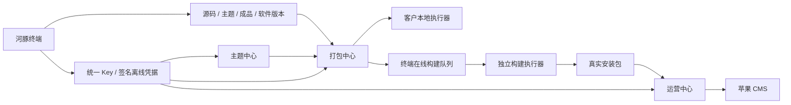

# 架构与职责

## 产品关系

河豚终端是发布方的云端管理软件。主题中心制作模板；打包中心把兼容模板与客户端源码组合；运营中心部署在客户服务器，负责内容、功能开关、广告及苹果 CMS 接入。终端不向苹果 CMS 写数据，现有产品保持自己的业务职责。

本版实现图中终端侧能力及协议。三个产品接入、主题渲染以及平台编译工具链不在终端进程内。服务器容器没有 Android SDK、Flutter SDK 或 Xcode。

## 服务结构

- `server/app.mjs`：HTTP 路由、会话、CSRF、文件下载和执行器协议。
- `server/store.mjs`：外部存储、原子写入、串行写请求、密码及签名密钥。
- `server/license.mjs`：授权、绑定、签名、版本与域名校验。
- `server/packages.mjs`：版本发布、源码/主题检查、构建任务兼容规则。
- `server/zip.mjs`：ZIP 目录读取、路径/大小/CRC/链接等检查；不在服务中解压执行源码。
- `public/`：原生 HTML/CSS/JavaScript 管理界面，与后端 API 同源。
- `deploy/`、`scripts/`：容器部署、本地启动和 Linux 管理菜单。

所有界面数据来自服务端。无虚拟客户、虚拟激活次数或模拟成功任务。Key 明文不进入列表、操作记录或数据库；管理员也无法查看原 Key，只能轮换。任务日志会隐藏已识别的河豚 Key/令牌格式。

## 生命周期

1. 管理员创建客户和授权。
2. 对应产品提交 Key、产品标识、设备或域名、客户端版本及随机数。
3. 服务端检查权限、有效期和名额，创建/复用绑定并签发离线凭据。
4. 客户端验签并安全保存凭据，按检查时间联网复查；联网发现授权拒绝则立即停止受限操作。
5. 断网只允许在凭据到期前继续本地已授权功能。下载目录、在线构建等联网功能仍依赖终端可访问。

域名绑定是授权配置校验，不是服务器所有权证明；设备 ID 也不是硬件远程证明。后续产品需保护本地存储、限制系统时钟回拨和校验自身设备/域名。这套首版机制不宣称能抵御客户端二进制被完全篡改。

## 发布与构建

上传的版本为草稿，发布后才能出现在客户目录。软件更新分别属于三个产品，APP 源码/主题/成品属于客户端。更新标记是协议数据，真正的提示、下载、替换安装由三个产品实现。

源代码是任意程序，编译只能在隔离执行器中进行。执行器须限制 CPU、内存、网络和工作目录，分别管理 Android/iOS/Windows 的签名凭据。终端不接收签名私钥来编译，也不在自身 HTTP 进程内执行源码。iOS 真正编译需要具备对应平台工具链的执行器。

任务状态：`queued → running → complete/failed/cancelled`。五分钟没有心跳则失败；终端重启时运行中的任务明确标记失败；客户授权过期/停用取消其未结束任务。产物只有执行器上传并通过基本格式及哈希校验后才允许下载。

## 持久化与升级

每次写请求串行执行，JSON 使用临时文件后原子替换，异常时回退内存快照。管理员密码为 scrypt 哈希，Key/节点令牌为高熵随机值的 SHA-256 哈希。服务只支持单进程写入；需要横向扩容时先迁移数据库。

升级前停服生成一致备份，包含配置、授权、上传文件及密钥。升级启动失败回退上个程序/配置；数据库格式不兼容时须从备份恢复，不能把程序回退等同数据迁移回退。保留签名私钥确保升级与恢复后原凭据仍可验证。

## 简化授权与成品更新（2026-10-14）

管理员在授权中心直接维护每个 Key 的名称、域名、三个产品权限和到期时间；底层客户关联保留兼容旧数据，新增流程无需选择客户。编辑授权名称不会更改同客户其他授权的名称。高级配额与模式设置折叠保留。

产品软件版本页提供“更新、推送、产品设置”。管理员 POST `/api/repositories/{product}/update` 获取绑定仓库最新稳定 GitHub Release 的受支持成品附件，整批完成下载、大小与哈希校验后自动发布。源码、清单与校验文件不会当作软件发布；只有源码或不支持的附件时不产生软件版本。下载或校验失败保留原发布版本。同版本文件合并显示，手动上传和源码操作保留在折叠区。

管理员 POST `/api/update-pushes/send` 对已发布的软件版本进行整批推送，支持全部授权或指定 `licenseIds`、更新说明和强制标记。发布与推送分开，更新操作不会自动创建推送。客户端更新接口按实际授权筛选，返回内容不暴露目标授权列表；接收与安装结果依赖产品真实回报。历史客户范围推送继续兼容。
