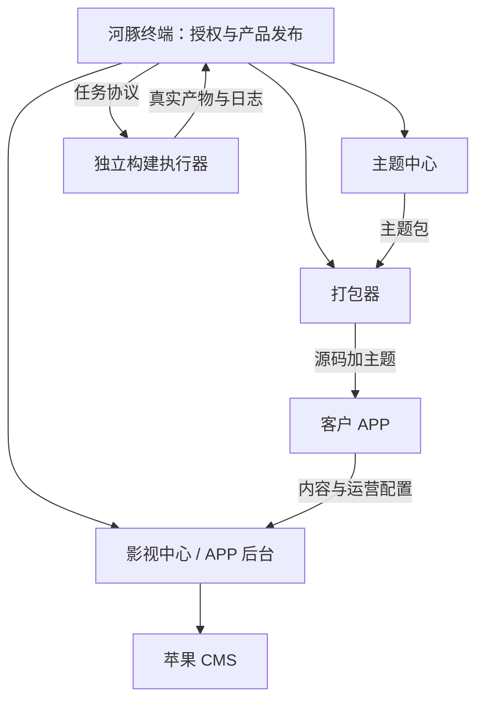

# 河豚终端架构与职责

定界日期：2026-10-14。本文是后续开发的职责依据；“目标”表示约定，“现状”表示已核对的实现，不能用设计代替验收结果。

## 系统定位

河豚终端负责授权、产品发布、通知分发和交付记录。三个产品独立安装、独立升级，通过统一协议连接终端。一个 Key 可以开通三个产品，各产品分别登记安装身份、权限和版本。

| 系统 | 自己负责 | 与终端交换 |
| --- | --- | --- |
| 河豚终端 | Key、产品权限、授权域名、策略、版本、公告、推送、记录、终端迁移 | 签名授权与配置、资源目录、更新清单、回执 |
| 主题中心 | 主题项目、骨架与视觉样式、实时预览、主题导入导出 | 激活、模板目录、主题导出记录、软件公告与更新 |
| 打包器 | APP 源码选择、主题组合、品牌与安装包参数、本地编译及下载 | 激活、源码和模板目录、构建任务、打包记录、软件更新 |
| 影视中心〔APP 后台〕 | 苹果 CMS 接入、分类与导航绑定、模块开关、广告、会员、APP 用户公告与更新 | 站点授权、影视中心软件更新、管理软件公告和运行记录 |

主题中心定义样式和可编辑能力，影视中心配置实际分类、栏目和运营内容。终端面向软件客户发布的公告，与影视中心面向观众发布的 APP 公告分别存储、分别生效。

## 管理界面边界

目标为六个入口：工作台、授权中心、产品中心、通知中心、记录中心、系统管理。产品中心保留主题中心、打包器、影视中心三个独立工作区；云端打包归入打包器工作区。

现状主菜单是工作台、授权中心、产品中心、通知中心、云端打包、系统管理。本文确定目标，尚未移动菜单。记录中心目标是汇总授权日志、产品事件和管理员操作记录，底层数据仍按业务归属保存，不把公告混入云端记录。

授权中心直接填写名称、域名、产品权限、模式和期限生成 Key。客户资料是可选附属信息，不要求先建客户。历史 customerId 保留兼容；名称不是身份主键。

## 授权规则与身份

| 身份 | 含义 | 约束 |
| --- | --- | --- |
| licenseId / Key | 一份商业授权及其凭据 | Key 只展示一次，终端保存哈希；轮换后旧 Key 无效 |
| product | theme-center、packer、operations | 共用 Key，各自校验产品权限 |
| activationId / binding | 产品在具体设备或站点的安装身份 | 重试复用同一身份；设备与站点名额分别计算 |
| authorizedDomains | 许可的业务域名范围 | 与终端自身访问域名分开；绑定不是域名所有权证明 |
| keyId / 公钥 | 终端签名身份 | 客户端固定信任公钥；私钥仅在终端运行目录 |

取消一个产品权限只影响该产品；停用、删除或轮换整个 Key 影响其全部产品。删除保留历史审计与产品记录，不能把删除当作清除使用历史。现有删除流程删除授权与绑定，保留撤销墓碑和历史记录；历史归档与保存期限仍需后续治理。

| 模式 | 启动规则 | 断网规则 | 可信拒绝 |
| --- | --- | --- | --- |
| 在线 online | 已保存 Key，每次启动认证；用户无需重复输入 | 新签名许可从成功认证起最多宽限72小时，且不超过授权期限；重启不延长 | 停止受限操作，返回激活入口 |
| 静默本地 silent-local | 已取得签名许可即可本地启动，每次启动后台询问，失败不弹窗 | 验签、产品、设备、期限均有效时继续本地功能；支持许可允许的离线迁移 | 停止受限操作，不把拒绝当作网络故障 |

现状服务端租约为 schemaVersion=4。新 online 许可携带 onlineGraceSeconds=259200、checkIntervalSeconds=60；exp 为签发时间加72小时与授权到期时间的较早值。主题客户端已接入启动认证、可信撤销持久化、SSE催促认证及60秒轮询。旧 online 许可继续执行旧版严格新鲜度规则，成功认证后换取新许可。打包器、影视中心尚未完成这一批客户端接入验收。详见 authorization-rules.md。

本地终端已有 /v1/license/watch SSE 通知及主题客户端联测证据，本批授权扩展为本地未提交改动。SSE 用于催促重新认证，鉴权接口才决定权限。运行中推送与周期检查共同工作；断开网络的设备无法收到即时撤销，静默离线许可只能在可信重连后取得最新策略。在线“删除即停”须明确实际传播时间，不能承诺零延迟。

离线迁移保存许可、设备迁移链和待补传事件；恢复连接后重新核对名额和权限。离线使用仍受授权期限约束。设备 ID 和本地签名校验不能保证抵御完全篡改的客户端；历史离线 IP 无法通过恢复连接的 IP 精确还原。

## 发布、通知与记录

1. 管理员为每个产品绑定 Git 仓库，检查提交与稳定 Release。
2. “更新”获取受支持的成品附件，下载、校验、整批成功后自动发布。没有成品的提交不自动编译，也不产生可安装版本。
3. 选择已发布版本与目标范围建立推送；已有定向推送的版本遵守推送生效范围。公开发布不能冒充定向通知。
4. 产品检查签名清单，展示更新，下载并核对文件；本地安装器执行替换、重启和失败恢复。
5. 新程序确认实际运行版本后上报安装结果；下载成功不能记录成安装成功。

手动上传和 /import 先进入草稿；/update 成品同步经过校验后自动发布。主题模板属于资源目录，主题中心读取和安装模板；产品源码 ZIP、软件安装包、APP 源码、APP 成品各自分类。闭源产品的源码分发必须受权限约束，不能默认向全部客户开放。

公告、更新推送、产品记录互相独立：公告记录阅读；推送记录接收与安装；产品记录保存主题导出、模板安装、本地打包等事件的元数据。当前记录接口不会自动上传完整主题项目或源码。完整项目云备份如要增加，需独立设计文件、权限和保留规则。

IP 以服务端可信入口获得，代理头仅在受信代理配置下使用。国家为可选查询结果，内网或查询失败显示未知；不保证定位精确。离线补传必须区分客户端发生时间、服务端接收时间、重连 IP。

## 模块与接口归属

| 模块 | 职责 / 接口范围 |
| --- | --- |
| server/app.mjs | HTTP、会话、CSRF、路由分发、下载和节点协议；避免继续堆积业务规则 |
| server/authorization-watch.mjs、server/instance.mjs | 授权通知连接管理、运行目录实例保护；具体部署边界见 runtime-reliability.md |
| server/store.mjs | 持久化、串行写入、密码哈希、签名身份 |
| server/license.mjs / authorization-log.mjs | 激活、复查、权限、绑定、授权日志；/v1/license/* |
| server/authority.mjs | 签名地址配置与信任迁移；/v1/terminal-config、身份及回执 |
| server/packages.mjs / zip.mjs | 资源发布、兼容检查、构建队列、包校验；/v1/catalog、/v1/jobs |
| server/product-center.mjs | 仓库同步、产品目录和元数据记录；/api/repositories/*、/v1/product-catalog、/v1/records |
| 通知业务 | 产品公告、定向更新、阅读与安装回执；具体契约见 update-notifications.md |
| public/ | 同源管理 UI；展示真实状态，业务权限由服务端校验 |
| deploy/ / scripts/ | 安装、升级、备份、域名入口、Linux 菜单；与业务授权分开 |

模块可以在同一服务内独立维护，当前不拆微服务。编译必须在独立执行器运行，限制 CPU、内存、网络及工作目录，平台签名凭据由执行器管理。终端 HTTP 进程不执行上传源码；没有真实执行器时任务只能排队，不能制造成功安装包。

## 数据、部署与迁移

当前 JSON 存储为单进程串行写入、临时文件原子替换。正式 createTerminal 入口已有同主机实例保护与关闭时等待写入，跨容器不能依赖该保护；具体机制和限制见 [运行可靠性](runtime-reliability.md)。只允许一个正式写入端；多副本扩容前迁移事务数据库。授权日志、产品事件、发布历史容量和保留规则按实际代码执行，后续应增加归档治理，不能无限堆积。

Git 保存程序和文档；数据库、管理员凭据、签名私钥、上传文件、证书及工具链在外部运行目录。提交源码不等于发布安装包，提交本地改动不等于生产部署。

终端迁移导出加密整包，包含数据库、签名身份及引用的业务文件；新服务器先安装空白实例再导入。端口、证书和 Docker 入口按新服务器重建。导出密码与迁移包分开保存。具体格式与操作顺序以 migration.md 为准。

同域名迁移保持原公钥，DNS 切换后客户端继续连接。换域名通过原私钥签名的新地址配置与可信重连完成；必须保留旧地址或已知备用入口供长期离线客户端发现。面板改域名不能通知完全失去旧入口的客户端。迁移宽限不得越过客户授权期限，旧新服务器不得同时发布策略。

## 当前交付证据与后续门槛

- 主题客户端 b482f10 已上传 Puffer-zhutiqi；配置实际本地终端源码运行 20/20 测试通过，前端资源构建通过。
- 已完成主题客户端生产连接联测：激活、公告与阅读回执、更新检查、记录、静默断网与恢复、删除测试授权后主动复查锁定。未测量生产 SSE 撤销延迟。
- 本轮未验收正式安装包下载替换与升级后重启回执；打包器、影视中心接入仍需在各自仓库完成。
- 本文仅交付架构定界和文档一致性修正，没有移动 UI 菜单、改写业务实现或部署服务器。

后续按顺序验收：三产品启动及撤销一致性 → 真安装包升级与回执 → 独立记录入口与保留策略 → 实际构建执行器 → 迁移及旧地址回连。每项用真实请求和产物证明，不用页面按钮存在代替功能完成。
